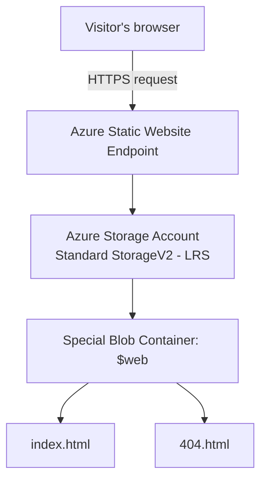

# Azure Blob Storage — Static Website Hosting

  

> **Project 01 · Azure Cloud Engineering Hands-On Lab**
>
> Deploy a public static HTML website using **Microsoft Azure Blob Storage** and the Azure Portal — without provisioning or managing a virtual machine.

### 🔗 Live demo

**Website:** https://afascloudportfolio01.z7.web.core.windows.net/

## Project overview

This hands-on lab documents how I created an Azure Resource Group and a Standard general-purpose v2 Storage Account, configured the `$web` container for static website hosting, uploaded HTML files, and obtained a public HTTPS website endpoint.

**Scope:** This repository documents **static site hosting**, not App Service, a database, automated deployment, or disaster-recovery implementation.

## Architecture



## Azure resources and configuration

| Item | Deployed configuration |
| --- | --- |
| Subscription type | Azure for Students |
| Resource group | `rg-cloud-portfolio` |
| Storage account | `afascloudportfolio01` |
| Storage account region | **East Asia** |
| Account type | General-purpose v2 (`StorageV2`) |
| Performance | Standard |
| Redundancy | Locally redundant storage (`LRS`) |
| Static website | Enabled |
| Index document | `index.html` |
| Error document | `404.html` |
| Website container | `$web` |
| Endpoint | `https://afascloudportfolio01.z7.web.core.windows.net/` |

**Note:** LRS keeps multiple synchronous copies inside a single primary-region datacenter. It is not a separate backup or cross-region disaster-recovery solution.

## Deployment walkthrough (Azure Portal)

1. Open [Azure Portal](https://portal.azure.com/) and select the **Azure for Students** subscription.
2. Create Resource Group `rg-cloud-portfolio`.
3. Create a **Storage Account** using **Standard**, **StorageV2 / general purpose**, **LRS**, and **East Asia** region. Choose a globally unique lowercase storage account name (our example is `afascloudportfolio01`).
4. Open the Storage Account and navigate to **Data management → Static website**.
5. Enable static website hosting, set **Index document name** to `index.html` and **Error document path** to `404.html`, then **Save**.
6. Open **Data storage → Containers → `$web`**. Upload `index.html` and `404.html` from the repository root; do **not** upload the ZIP file.
7. Confirm the uploaded HTML files have **Content-Type: `text/html`**.
8. Return to **Static website**, copy the **Primary endpoint**, and open it in a browser.

> These are manual Portal steps. This repository is **not** an automated Terraform/Bicep or CI/CD deployment.

## Troubleshooting experience: Azure regional policy

The initial Storage Account deployment in **East US** failed with:

```text
InvalidTemplateDeployment
RequestDisallowedByAzure
This policy maintains a set of best available regions where your subscription can deploy resources.
```

**Root cause:** The Azure for Students subscription applied a resource-location policy, so a region accepted for the Resource Group was not necessarily allowed for the Storage Account.

**Resolution:** Reviewed **Azure Policy → Assignments → allowed locations** and selected **East Asia**, one of the permitted regions for this subscription. Retried the Storage Account deployment in that region and confirmed successful provisioning.

**Lesson learned:** Always check subscription policies, location restrictions, and deployment failures. A Resource Group's metadata location does not force all its resources to the same region.

## Repository structure

```text
azure-blob-static-website/
├── index.html             # Sample static site
├── 404.html               # Custom error page
├── README.md              # Project documentation
├── .gitignore             # Protect local secrets and tooling files
└── screenshots/
    └── README.md          # Screenshot checklist and privacy guidance
```

## Screenshots (evidence)

The `screenshots/` folder describes the screenshots to upload from the Azure Portal. Add evidence of the actual deployment, such as Storage Account Overview, enabled Static Website configuration, `$web` container files, and a browser view of the live site.

**Do not publish** subscription IDs, credentials, account access keys, SAS tokens, or sensitive personal details in screenshots.

## What I learned

- Organizing Azure resources using Resource Groups.
- Provisioning a general-purpose v2 Azure Storage Account.
- Choosing Standard performance and understanding **LRS** redundancy.
- Hosting static files using the Blob Storage **`$web`** container.
- Accessing a public static website through its HTTPS endpoint.
- Diagnosing an Azure deployment restriction using subscription policy and allowed regions.

## Limitations and follow-up labs

- The sample page is a static site; there is **no application backend or database**.
- LRS replication and Blob soft delete are **not substitutes for an independent backup**.
- Azure Storage use and transactions may incur charges. Check the Azure for Students balance and set Cost Management alerts.
- **Not yet documented as completed:** Blob soft-delete recovery test, Azure Monitor analysis, automated CI/CD, or Infrastructure as Code. These can be added as separate labs.

## Reproduce / view locally

Download or clone this repository and open `index.html` in a browser. To deploy your own copy, create a Storage Account and follow the steps above, replacing the storage account name and endpoint with yours.

## Helpful documentation

- [Host a static website in Azure Storage](https://learn.microsoft.com/en-us/azure/storage/blobs/storage-blob-static-website-how-to)
- [Azure Storage redundancy](https://learn.microsoft.com/en-us/azure/storage/common/storage-redundancy)
- [Azure Policy overview](https://learn.microsoft.com/en-us/azure/governance/policy/overview)

---

**Project status:** Initial static website deployment completed. Additional recovery and monitoring labs remain future work.
